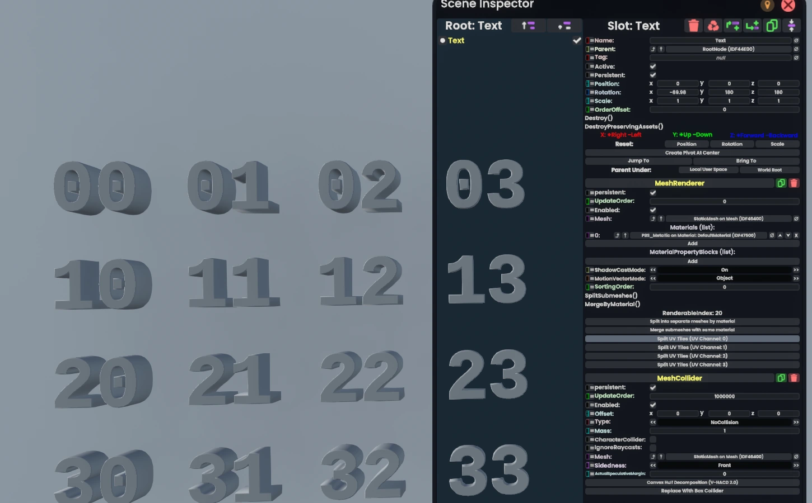
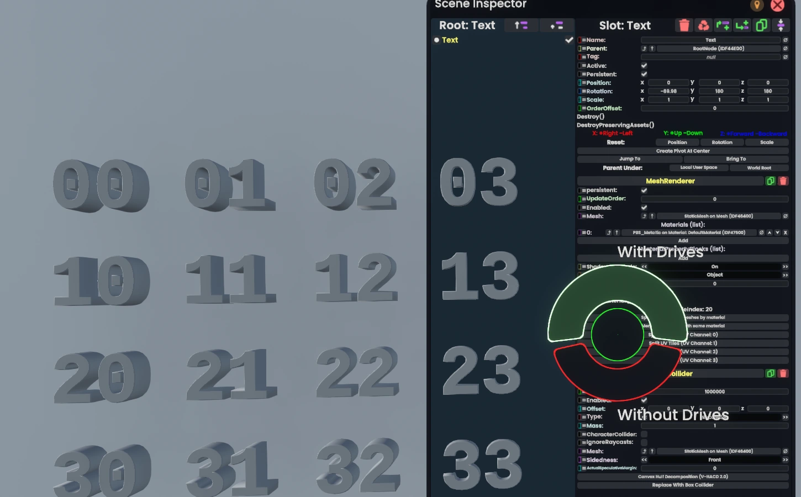
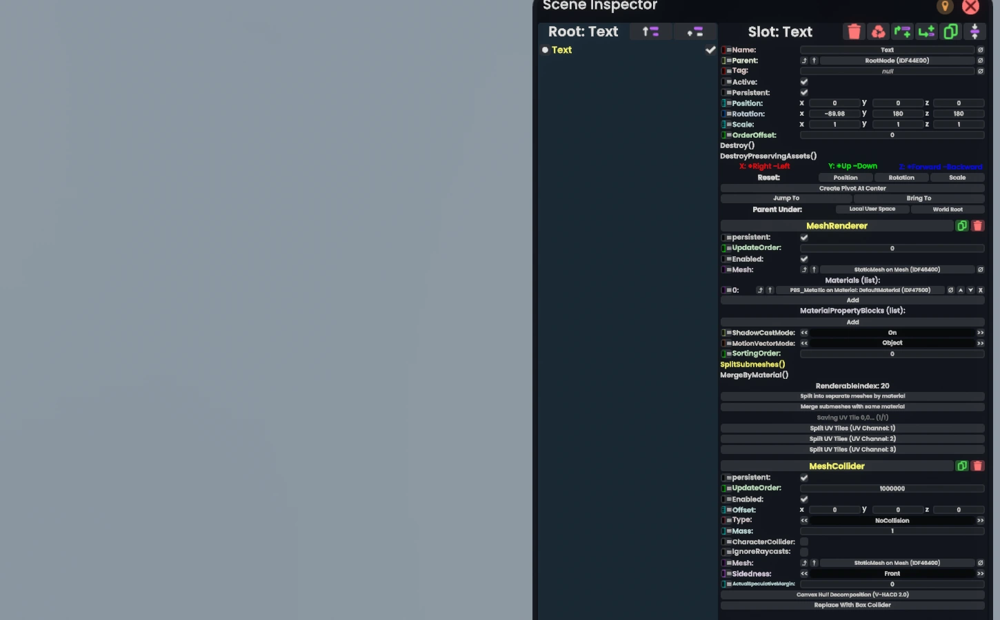
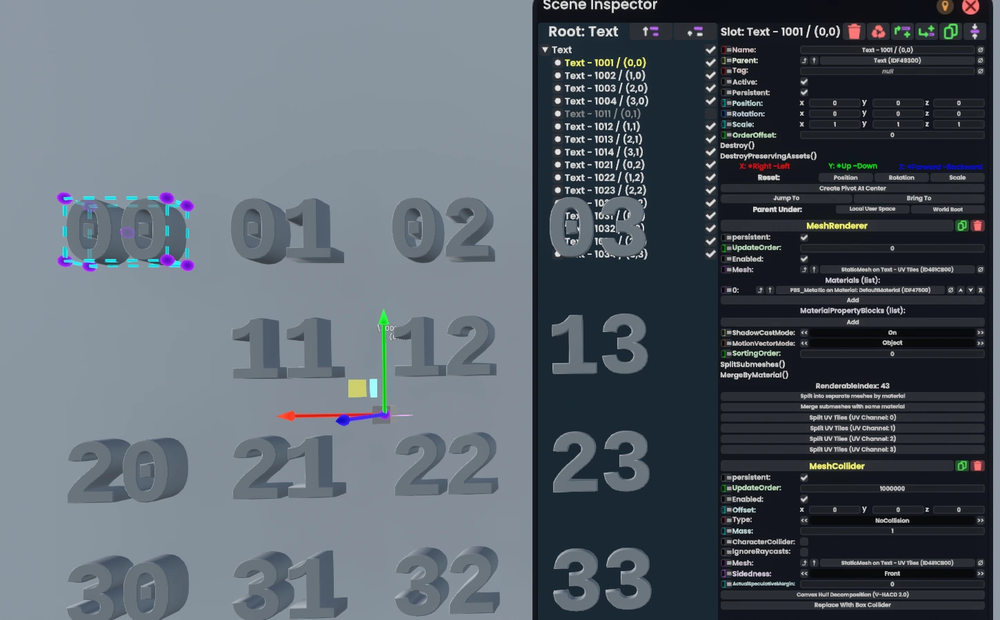
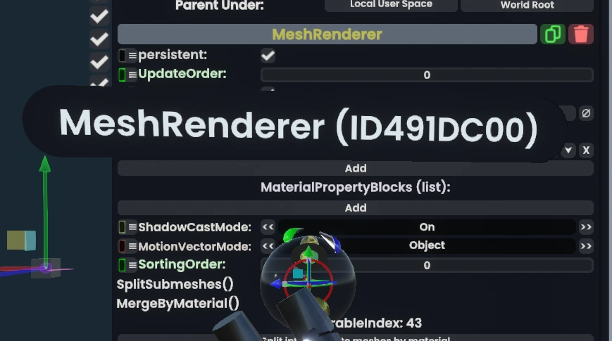
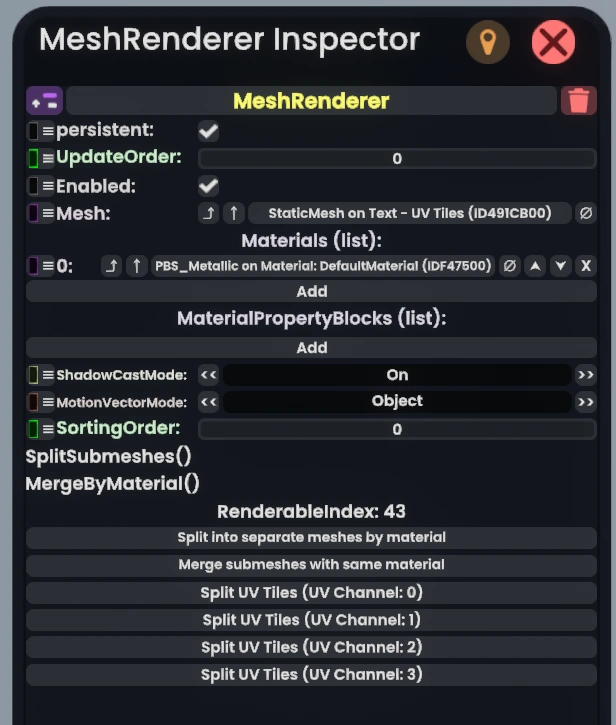

# ResoniteUVTileSplitter

Do you want to use avatars with UDIM/UV tiles within [Resonite](https://resonite.com/)?
They are commonly used to toggle parts like clothing of an avatar within VRChat.
The current materials/shaders within Resonite don't support that. (see [#4465](https://github.com/Yellow-Dog-Man/Resonite-Issues/issues/4465))

There is a solution, though: One can cut the models into pieces (one per tile).
There is no performance metric that discourages that!

This mod gives the user or - if enabled - other users within the session the ability to cut meshes into UV tiles.
The individual meshes can then be toggled or textured differently.

## Installation
1. Install [ResoniteModLoader](https://github.com/resonite-modding-group/ResoniteModLoader).
1. Place [ResoniteUVTileSplitterName.dll](https://github.com/YourGithubUsername/YourModRepoName/releases/latest/download/ResoniteUVTileSplitterName.dll) into your `rml_mods` folder. This folder should be at `C:\Program Files (x86)\Steam\steamapps\common\Resonite\rml_mods` for a default install. You can create it if it's missing, or if you launch the game once with ResoniteModLoader installed it will create this folder for you.
1. Start the game. If you want to verify that the mod is working you can check your Resonite logs.

## Usage / Screenshots
1. [Inspect](https://wiki.resonite.com/Scene_Inspector) the avatar and locate the ([`Skinned`](https://wiki.resonite.com/Component:SkinnedMeshRenderer)-)[`MeshRenderer`](https://wiki.resonite.com/Component:MeshRenderer)!
1. Press the button "Split UV Tiles (UV Channel: #)" where # is the UV channel of your choice!

1. Choose if the resulting renderer's blendshapes should be connected via [`ValueCopy`](https://wiki.resonite.com/Component:ValueCopy)! 
1. Wait a bit! 
1. The mesh has been split per UV tile. Repeat for other renderers that need to be split. 

The mod's utilities can be shared with other users within a session if the matching mod option is enabled.
Inspector UI is generated by the host of the session by default.
If you are not the host you can spawn a modded component inspector with the following steps:
1. Grab the reference to a (`Skinned`-)`MeshRenderer`! 
1. Press primary action (i.e. trigger/left click) to spawn a component inspector including the mod actions! 
